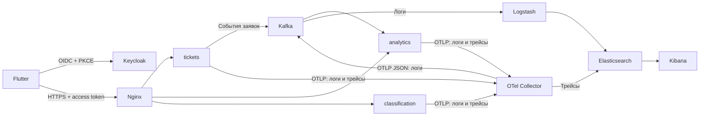

# Архитектура

## Стек и устройство

| Компонент | Технологии | Назначение |
| --- | --- | --- |
| Мобильный клиент | Dart, [Flutter](https://docs.flutter.dev/reference/supported-platforms) | Общий интерфейс для Android и iOS, включая диаграммы. |
| API-шлюз | Nginx | HTTPS, маршрутизация запросов и балансировка экземпляров сервисов. |
| Микросервисы | Python, [FastAPI](https://fastapi.tiangolo.com/features/) | Независимые REST API заявок, аналитики и классификации. |
| Хранение данных | [PostgreSQL](https://www.postgresql.org/docs/current/tutorial.html), SQLAlchemy | Отдельные базы заявок и аналитики; собственная база Keycloak. |
| Машинное обучение | scikit-learn: [TF-IDF](https://scikit-learn.org/stable/modules/generated/sklearn.feature_extraction.text.TfidfVectorizer.html) и [логистическая регрессия](https://scikit-learn.org/stable/modules/generated/sklearn.linear_model.LogisticRegression.html) | Преобразование текста в признаки и классификация категории. |
| Авторизация | [Keycloak](https://www.keycloak.org/securing-apps/oidc-layers), OpenID Connect | Вход, роли, выдача и обновление токенов. |
| События | [Apache Kafka](https://kafka.apache.org/44/getting-started/introduction/) | Асинхронная доставка изменений заявок и буферизация логов. |
| Сбор телеметрии | OpenTelemetry SDK, [OTel Collector Contrib](https://opentelemetry.io/docs/collector/) | Отдельный слой приёма, пакетной обработки и экспорта логов и распределённых трейсов. |
| Хранение и просмотр телеметрии | Elasticsearch, Logstash, Kibana (ELK) | Нормализация логов, хранение, поиск и визуализация логов и трейсов. |

### Микросервисы

| Сервис | Ответственность | Собственные данные |
| --- | --- | --- |
| `tickets` | Реестр, карточки, история, назначение исполнителей, статусы и CSV-экспорт. Публикация изменений в Kafka. | Заявки, история и очередь исходящих событий в PostgreSQL. Пользователи связаны по `sub` из Keycloak. |
| `analytics` | Получение событий из Kafka, обновление проекции заявок и REST API дашборда. Доступ только администратору. | Проекция заявок и обработанные события в отдельной базе PostgreSQL. |
| `classification` | REST API подсказки категории, обучение и загрузка модели. | Файл модели. Размеченная выборка поступает при обучении через внутренний экспорт сервиса заявок. |

У каждого прикладного сервиса собственные Dockerfile, зависимости и Compose-проект. Образ включает только этот сервис и общую библиотеку проверки токенов и телеметрии. Сервисы не читают чужие базы: у tickets, analytics и Keycloak отдельные экземпляры PostgreSQL. Инфраструктурные компоненты также имеют отдельные Compose-проекты и связаны внешней сетью `zayavka`. В локальном профиле шлюз использует HTTP; при внешнем размещении перед ним настраивается HTTPS. Для работы приложения требуется подключение к сети.

### Вход и права доступа

Мобильное приложение использует OpenID Connect Authorization Code Flow с PKCE через системный браузер. Это публичный клиент Keycloak без встроенного секрета. Refresh token хранится в защищённом хранилище устройства. Пароли обрабатывает Keycloak.

Каждый REST API проверяет подпись access token по JWKS Keycloak, `issuer`, свою `audience` и срок действия. Роли `employee`, `executor`, `admin` передаются в токене; принадлежность заявки проверяет сервис `tickets`. Для API настраиваются audience-mapper в Keycloak. Внутренний экспорт обучающей выборки доступен только сервисной учётной записи классификатора через Client Credentials.

Scope `basic` добавляет идентификатор пользователя `sub`. Сервис `tickets-service` получает роли чтения пользователей и scope `kc-admin-api` с audience административного API Keycloak. У публичных клиентов эти административные права отсутствуют.

### Kafka и масштабирование

Сервис `tickets` записывает изменение заявки и исходящее событие в одной транзакции PostgreSQL (transactional outbox). Фоновый отправитель публикует событие в Kafka и повторяет отправку при сбое. Событие содержит `event_id`, `ticket_id`, версию заявки, время изменения и снимок полей для аналитики.

| Топик | Ключ сообщения | Потребитель | Партиции / реплики |
| --- | --- | --- | --- |
| `ticket.events` | `ticket_id` | Группа `analytics` | 3 / 1 |
| `telemetry.logs` | Не требуется | Группа `logstash` | 3 / 1 |

Образ Kafka автоматически форматирует хранилище KRaft со статическим кворумом одного узла; `kafka-init` создаёт оба топика с тремя партициями и одной репликой. Данные брокера сохраняются на постоянном томе. Профиль использует PLAINTEXT внутри закрытой сети. Исполняемая конфигурация находится в [Compose-проекте Kafka](../src/infrastructure/kafka/compose.yaml).

Продюсер событий использует `acks=all` и идемпотентную отправку. Аналитика отключает автоматическую фиксацию offset: обновляет проекцию и сохраняет `event_id` в одной транзакции, затем подтверждает обработку. Повторы игнорируются по `event_id`, устаревшие снимки — по версии заявки. Доставка имеет семантику at-least-once.

При росте нагрузки добавляются экземпляры HTTP-сервисов за шлюзом и потребители с тем же `group.id`. Три партиции позволяют одновременно работать до трёх потребителей в каждой группе. Новому независимому обработчику назначается своя группа. Мобильные клиенты работают через REST API. Один брокер не обеспечивает отказоустойчивость; для неё нужен кластер с репликацией данных.

### Логи и распределённые трейсы

Все три сервиса инструментируются OpenTelemetry SDK: HTTP-запросы, обращения к PostgreSQL, публикация и обработка событий Kafka. Контекст W3C Trace Context передаётся в HTTP-заголовках и заголовках Kafka; outbox сохраняет контекст исходного запроса для отправителя. Логи содержат `service.name`, уровень, время, `trace_id` и `span_id` для записей внутри активного span. Это связывает запрос, публикацию события и обработку аналитикой в одну трассу.

OTel Collector Contrib принимает логи и трейсы по OTLP на портах 4317 (gRPC) и 4318 (HTTP), применяет ограничение памяти, пакетную обработку и повторные попытки отправки. Используются отдельные конвейеры:

- Логи: Collector → Kafka `telemetry.logs` с кодировкой [`otlp_json`](https://github.com/open-telemetry/opentelemetry-collector-contrib/tree/main/exporter/kafkaexporter) → [Logstash Kafka input](https://www.elastic.co/docs/reference/logstash/plugins/plugins-inputs-kafka) → Elasticsearch. Logstash разбирает пакеты OTLP на отдельные записи и нормализует время, имя сервиса, уровень и идентификаторы трейса и span.
- Трейсы: Collector → [Elasticsearch exporter](https://github.com/open-telemetry/opentelemetry-collector-contrib/tree/main/exporter/elasticsearchexporter) в режиме `otel` → отдельные потоки данных Elasticsearch.

Kibana используется для поиска логов по сервису и идентификатору трассы, просмотра связанных span и их длительности. Для данных в формате OTel устанавливаются [совместимые пакеты визуализаций](https://www.elastic.co/docs/solutions/observability/apm/opentelemetry). Пароли, токены и полные тексты заявок в телеметрию не включаются.
